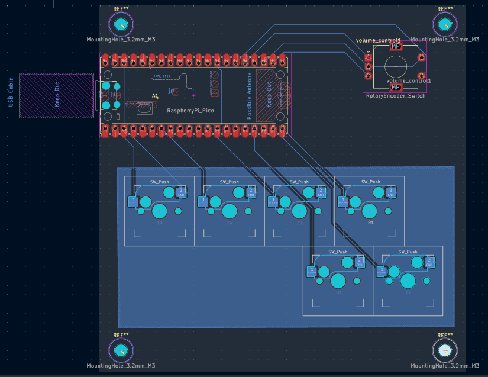

# Custom Hot-Swappable Macropad for League of Legends

## Overview

This project implements a custom USB macropad using the Raspberry Pi Pico.
The macropad is designed for League of Legends, providing dedicated QWER ability
keys, DF keys, and a future joystick + volume knob expansion for character movement using League's new WASD support. The firmware is written in C using the
Raspberry Pi Pico SDK, and the final hardware is designed in KiCad and
manufactured as a custom PCB.

## Hardware Design

The PCB is designed in KiCad for a Raspberry Pi Pico-based USB HID macropad (also compatible with the Raspberry Pi Pico 2). The board is intended to support six mechanical keyboard switches, with hot-swap sockets for easier switch replacement. The PCB will connect each key to a dedicated GPIO pin, with the switches sharing a common ground. The PCB design will accommodate a rotary encoder with push button for future volume-control functionality.

### PCB Specifications

- **EDA software:** KiCad 10
- **Microcontroller:** Raspberry Pi Pico
- **Input switches:** 6 mechanical keyboard switches
- **Switch mounting:** Kailh CPG151101S11 hot-swap sockets
- **PCB layout:** Custom-designed PCB with a 4-key top row and 2 additional keys on the right side
- **Enclosure:** Custom 3D-printed case (planned)
- **Connectivity:** USB through the Pico's onboard connector
- **Firmware:** C using the Raspberry Pi Pico SDK and TinyUSB

### Hardware Components

| Component | Purpose | 
|---|---|
| Raspberry Pi Pico | Microcontroller and USB HID interface |
| Kailh CPG151101S11 hot-swap sockets | Allow switches to be replaced without desoldering |
| MX Mechanical keyboard switches | Physical key inputs |
| Custom PCB | Mounts switches and microcontroller connections |
| Header pins / sockets | Connects the Pico to the PCB |
| 3D-printed enclosure | Houses and protects the assembled macropad |
| (Optional) Rotary encoder | volume control knob |

### GPIO Mapping

| Key | Pico GPIO | Physical Pin |
|---|---:|---:|
| Q | GP01 | 02 |
| W | GP05 | 07 |
| E | GP09 | 12 |
| R | GP15 | 20 |
| D | GP13 | 17 |
| F | GP14 | 19 |

The switches use a shared ground connection, with GPIO internal pull-ups intended to be enabled in firmware.

### PCB Development Roadmap

- [x] Create the initial schematic
- [x] Assign initial switch footprints
- [x] Import the schematic into the PCB editor
- [x] Finalize component placement and board outline
- [x] Verify switch socket and Pico header footprints against physical components
- [x] Route PCB traces
- [x] Run electrical and design-rule checks
- [x] Generate manufacturing files
- [x] Manufacture and assemble the PCB
- [ ] Design and print the enclosure
- [ ] Test the assembled macropad

*The PCB is a work in progress. Footprint compatibility, electrical connections, clearances, and manufacturing outputs must be verified before fabrication.*

## Project Roadmap

- [x] Prototype button circuit on a breadboard
- [x] Test each switch and verify wiring
- [x] Develop firmware for button detection and debouncing
- [x] Implement USB HID keyboard functionality
- [ ] Add macro support
- [x] Design the schematic in KiCad
- [x] Route and manufacture the PCB
- [ ] Assemble and test the final board
- [ ] Design and print a case

## Technologies
- C
- CAD (3D Printed Case)
- Raspberry Pi Pico SDK
- TinyUSB
- KiCad
- Git
- VS Code

## Button Module Specifications

### Purpose

The button module provides an interface for initializing and scanning the macropad's pushbuttons. It abstracts the GPIO hardware and reports button press and release events.

### Functional Requirements
- Initialize all configured GPIO pins as digital inputs.
- Enable the Raspberry Pi Pico's internal pull-up resistors.
- Scan all buttons periodically.
- Detect button press events.
- Detect button release events.
- Generate exactly one press event for each physical press.
- Generate exactly one release event for each physical release.

### Assumptions
- Buttons are active-low.
- One side of every switch is connected to a GPIO pin.
- The opposite side is connected to ground.
- Internal pull-up resistors are enabled.
- buttons_scan() is called periodically from the main loop.
